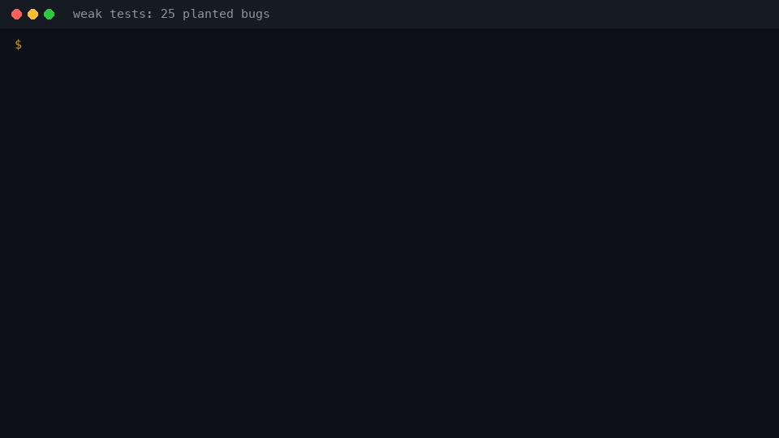

# Prove your tests

**Your tests pass. Do they catch bugs? Prove it.**

[](https://github.com/quartercharts-com/prove-your-tests)  



Measured on the example in this repo (reproduce with `bash examples/shop/run_demo.sh /tmp/r`):

| Tests | Planted bugs caught |
| --- | --- |
| a few happy-path tests | **10 of 25** (FAIL) |
| a guard that greps the code for a pattern | **8 of 46** escape plants (FAIL) |
| a guard that checks the effect (the money) | **25 of 25** and **46 of 46** (PASS) |

## Try it in 60 seconds

```bash
pipx install git+https://github.com/quartercharts-com/prove-your-tests
git clone https://github.com/quartercharts-com/prove-your-tests && cd prove-your-tests
PYT=prove-your-tests bash examples/shop/run_demo.sh /tmp/r && cat /tmp/r/weak-tests-vs-code-changes.md
```

The first report shows 15 SURVIVED plants: each one is a line no test checks.

## Use it with your AI

| Tool | Add this |
| --- | --- |
| Claude Code | `/plugin marketplace add quartercharts-com/prove-your-tests` then `/plugin install prove-your-tests@quartercharts-com` |
| OpenAI Codex and other agents | copy `adapters/AGENTS.md` into your repo |
| Cursor | copy `adapters/cursor/prove-your-tests.mdc` to `.cursor/rules/` |
| Gemini CLI | copy `adapters/GEMINI.md` into your repo |
| Any MCP client | `{ "mcpServers": { "prove-your-tests": { "command": "prove-your-tests", "args": ["mcp"] } } }` |

Then ask: "prove the tests for refunds". The AI writes plants without reading your tests; the verdict comes
from a script.

## Why you can trust it

- **It never leaves your code changed.** It refuses uncommitted work, journals every file before it touches it,
  and restores after a crash, Ctrl-C, a kill or a closed terminal; `recover` handles `kill -9`. Each case is a
  test in `tests/test_prover.py` (class `Safety`).
- **No AI decides PASS.** The verdict is a plain script. A timeout or a flaky test is NOT-RUN, never a kill.
- **Keys stay yours.** The optional headless plant writer reads an API key only from an environment variable,
  never stores, prints or logs it (tested).
- **It proves itself.** 91 planted bugs in the runner itself, written by a separate writer that never read the
  self-test, run by CI.

## Where it helps

Illustrations of the kind of bug it exposes, not measured results. Longer examples: `docs/use-cases.md`.

| Area | A bug a green suite can hide | Plant form that finds it |
| --- | --- | --- |
| Payments and fintech | a limit compared as text ("100" < "50"); a blank amount becoming 0; a refund that can run twice | M1 compare, M4 constant, E-forms for a second path |
| E-commerce | a discount boundary `>=` vs `>`; a coupon applied after tax | M1 compare, M2 arithmetic |
| SaaS access and accounts | a permission check reached through a second route or an alias import | E1 alias, E9 second module |
| Dosage-style calculators | mg vs g, `age >= 18` vs `> 18`, untouched by happy paths | M1 compare, M4 constant |
| Data pipelines | NULL written as 0; a dropped row on a timeout; a second writer skipping validation | M4 constant, M8 dropped call, E9 |
| AI-written code | tests from the same model as the code share its blind spots | plants from a different model |
| Regulated teams | evidence that tests catch defects, beyond a coverage percent (can support audits; it does not make you compliant) | any |
| Open source maintainers | does a contributor's new test catch a regression? | `plant --lines` on the changed lines |

## How it compares

| | prove-your-tests | mutmut (Python) | Stryker (JS/TS, C#, Scala) | PIT (Java) |
| --- | --- | --- | --- | --- |
| Automatic mutants over a whole codebase | small: 9 behavior forms, Python and JS/TS | yes | yes, many operators | yes, fast bytecode mutation |
| Speed on big codebases | slow: a full test run per plant, twice | medium | incremental mode | fast, incremental |
| Escape plants for guards (15 evasion forms: aliases, getattr, second writers, raw SQL...) | yes | no | no | no |
| Plants written by a different author or AI that never reads the tests | yes, and checked | no | no | no |
| Works from any AI agent (Claude, Codex, Cursor, Gemini, MCP) | yes | no | no | no |
| Refuses dirty trees, journals, restores after kill -9 | yes | works on a copy or in place | works in a sandbox copy | in memory |
| Mature reports and IDE integration | no | basic | yes, dashboard | yes |

Use mutmut, Stryker or PIT for broad, fast mutation scores over a whole codebase. Use prove-your-tests where a
specific test or guard must be proven: money, accounts, access, and code an AI wrote.

## How it works

A green test only proves the test ran. This skill plants small deliberate bugs in your code, one at a
time. For each one it runs your tests, which must go **red**. It then puts the file back byte for byte and
runs the tests again, which must go **green**. Any planted bug your tests miss is a hole, and the skill
shows you where it is.

> Pre-release (before 1.0; versions and changes in [CHANGELOG.md](CHANGELOG.md)). MIT licensed. Works with any AI agent, or with none: the verdict is always a plain script.

## What it checks

- **Behavior:** if someone changes a line (`>=` to `>`, `50` to `51`, drops a call), does a test fail?
- **Guards:** if someone adds code that sneaks around a rule ("only `refund()` may move money"),
  through an alias, `getattr`, a stored function, an env flag, a second module, an error path, does the
  guard test notice?

## The rules that make the proof honest

1. **The plants are written by someone who never reads the tests.** A separate plant writer (an agent)
   sees only the code, a scan of how the code is really called, and a catalog of 24 bug forms. Plants
   chosen by the person who wrote the tests share the tests' blind spots.
2. **At least 25 plants, and every catalog form covered** (or marked not applicable, with a reason).
3. **PASS only when everything is proven:** every plant ran and turned the tests red, every file came
   back byte-identical, and the tests were green again afterwards. Anything not run is **NOT-RUN**, never
   PASS.
4. **The runner is a script, not a model.** No model reads test output to decide a verdict.
5. **A plant is never left behind.** The runner refuses uncommitted work, journals every file before it
   changes it, and puts files back after a crash, Ctrl-C, a kill or a closed terminal (`recover` after `kill -9`).
6. **A hang or a flaky test is never a kill.** Timeouts and tests that fail without a plant are NOT-RUN.

## The idea in one example

```python
def is_adult(age):
    return age >= 18

def test_adult():
    assert is_adult(30)
```

The test is green. The skill plants `age > 18`, and the test is still green: the plant **SURVIVED**.
Nothing checks the line itself, so an 18-year-old could be turned away and no test would notice. The
skill reports the hole, and you add the test that was missing:

```python
def test_the_line():
    assert is_adult(18)
    assert not is_adult(17)
```

Run it again on the same plants, and the plant is now **KILLED**.

## Worked example: a tiny shop

`examples/shop/shop.py` has refunds and a money ledger. The rule: money leaves only through `refund()`,
and a customer may refund at most 50. There are three sets of tests:

| Tests | What they check | Code-change plants (25) | Escape plants (46) |
| --- | --- | --- | --- |
| `test_shop_weak.py` | a few happy paths | **FAIL**: 10 caught, 15 missed | |
| `test_guard_pattern.py` | "no function but `refund` contains `LEDGER.append`" | | **FAIL**: 8 caught, 38 missed |
| `test_guard_effect.py` | runs every function as a customer and looks at the money | **PASS**: 25 of 25 | **PASS**: 46 of 46 |

The effect guard did not pass the first time. The skill found 3 real holes, and each became a test:

- **`MAX_SELF_REFUND = 50` changed to `51` went unnoticed.** The test read the code's own constant, so it
  moved with the change. Fix: write `50` and `51` into the test.
- **`amount <= 0` changed to `amount <= 1` went unnoticed.** No test refunded exactly 1. Fix: test the
  smallest legal refund.
- **A customer refund of 100 went through when the limit compared numbers as text.** As text,
  `"100" < "50"`. The test only tried 51, which happens to compare correctly. Fix: try 51, 99, 100, 499
  and 1000.

Run it yourself (it works on a copy, never on your files; needs `python3` and `git`):

```bash
bash examples/shop/run_demo.sh /tmp/shop-reports
cat /tmp/shop-reports/effect-guard-vs-escapes.md
```

## Install

Pick one. Nothing is on a package registry yet; every option installs from this repository.

| Option | Command | Tested here |
| --- | --- | --- |
| Command line (pipx) | `pipx install git+https://github.com/quartercharts-com/prove-your-tests` | wheel built and installed in a fresh venv, demo run through it |
| Command line (uv) | `uv tool install git+https://github.com/quartercharts-com/prove-your-tests` | same wheel |
| Claude Code plugin | `/plugin marketplace add quartercharts-com/prove-your-tests` then `/plugin install prove-your-tests@quartercharts-com` | manifests pass `claude plugin validate`; install from GitHub not run before release |
| Claude Code, by hand | copy `skill/prove-your-tests` to `~/.claude/skills/` and `agents/plant-writer.md` to `~/.claude/agents/` | yes |
| GitHub Action | `uses: quartercharts-com/prove-your-tests@v1` (sample: `examples/workflows/prove-your-tests.yml`) | the action's script is run by the self-test; not run on GitHub before release |
| MCP server | `claude mcp add prove-your-tests -- prove-your-tests mcp` (see below for other clients) | stdio protocol run by the self-test; client configs format-checked only |
| Other agents | copy `adapters/AGENTS.md` (Codex and others), `adapters/GEMINI.md` (Gemini CLI) or `adapters/cursor/prove-your-tests.mdc` (to `.cursor/rules/`) into your repo | format only |

Then, in Claude Code, ask to "prove the tests for refunds" or type `/prove-your-tests`. On the command line:

```bash
prove-your-tests plant --repo . --out plants.json src/refunds.py      # or have any AI write plants.json
prove-your-tests check-plants plants.json --repo .
prove-your-tests prove --repo . --plants plants.json --test-cmd "python3 -m pytest -q tests/test_refunds.py" --out .prove-out/refunds
```

MCP clients that take a JSON config (Claude Desktop, Cursor `.cursor/mcp.json`, and others):

```json
{ "mcpServers": { "prove-your-tests": { "command": "prove-your-tests", "args": ["mcp"] } } }
```

Not built yet: Homebrew and npm packages.

## Works with

- **Run here:** the command line with no model at all (plants given as a file), Claude Code (skill, plant-writer
  agent, plugin manifests validated), the MCP server (stdio, as a script), the headless plant writer against a
  local fake of the Anthropic and OpenAI-compatible APIs.
- **Format checked, not run:** OpenAI Codex and other `AGENTS.md` readers, Gemini CLI, Cursor rules, MCP
  configs for Claude Desktop and Cursor, the GitHub Action on GitHub, real calls to OpenAI, Anthropic,
  Moonshot (Kimi), DeepSeek or OpenRouter. ChatGPT connects only to remote MCP servers, so the local server
  does not plug into it directly.
- **Tested on:** macOS with Python 3.12. Declared for Python 3.9 or newer on macOS and Linux (CI). Windows is
  not tested.

## Which model for which step

| Step | Model |
| --- | --- |
| Running plants, restoring files, the verdict | none: a plain script |
| Behavior plants for Python and JS/TS | none: `prove-your-tests plant` |
| Escape plants (guard mode), plants for other languages | the strongest model you have, high effort |
| Simple, repetitive plants (one per site of a known form) | a cheaper model is fine |
| Writing the missing tests for survivors | the model that owns the tests, high effort |

The headless writer for CI takes any provider: `prove-your-tests write-plants --provider anthropic|openai
--model <name> [--base-url <OpenAI-compatible URL>] ...`. It reads the key only from an environment variable
(`ANTHROPIC_API_KEY`, `OPENAI_API_KEY`, or `--key-env`), never prints it, and writes nothing unless the model's
answer passes `check-plants` and every edit applies.

## Settings

`skill/prove-your-tests/config.default.json` holds the defaults. Copy it to `.prove-your-tests.json` in
your repo to change them.

- **Plant writer:** the strongest model, high effort. On a small plan, a cheaper model can write the
  simple, repetitive plants.
- **Runner:** no model.
- **Proof:** at least 25 plants, 3 green baseline runs, a control run after every plant, a 300 second timeout
  per run.

## The skill proves itself too

`tests/test_prover.py` checks the runner's own promises in 60 cases: verdicts, exit codes, stale plants,
created files, dirty trees, flaky tests, timeouts, apply failures, signals, a real `kill -9` and recovery,
shards. `tests/test_adapters.py` checks the CLI, the MCP server, the headless writer and the adapter files in
18 cases. `tests/plants/prover.json` holds 91 plants that would each make the runner lie, for example "count a
timeout as a kill", "skip the byte check" or "accept 24 plants when 25 are required", written by a separate
plant writer that never read the self-test. CI runs the self-test against all 91 in 8 shards
(`.github/workflows/ci.yml`).

## Files

| Path | What |
| --- | --- |
| `skill/prove-your-tests/SKILL.md` | the steps Claude follows |
| `skill/prove-your-tests/scripts/prove.py` | the runner: red, restore, byte check, green, verdict |
| `skill/prove-your-tests/scripts/plant.py` | code-change plants for Python and JS/TS |
| `skill/prove-your-tests/scripts/scan_forms.py` | how the code really reaches a guarded name (tests skipped) |
| `skill/prove-your-tests/scripts/plants_schema.py` | checks a plants file from any writer |
| `skill/prove-your-tests/scripts/union.py` | one verdict from a run split across machines |
| `skill/prove-your-tests/scripts/cli.py` | the `prove-your-tests` command |
| `skill/prove-your-tests/scripts/mcp_server.py` | the commands as MCP tools |
| `skill/prove-your-tests/scripts/write_plants.py` | optional headless plant writer (any provider) |
| `skill/prove-your-tests/prompts/plant-writer.md` | the plant-writer prompt, the same for every model |
| `skill/prove-your-tests/references/catalog.md` | the 24 bug forms (M1 to M9, E1 to E15) |
| `agents/plant-writer.md` | the plant writer as a Claude Code agent (same prompt) |
| `adapters/` | `AGENTS.md`, `GEMINI.md`, a Cursor rule |
| `action.yml` | the GitHub Action |
| `.claude-plugin/` | Claude Code plugin and marketplace manifests |
| `examples/shop/` | the worked example |

## Badge

Proved your tests? Add the badge to your README. It is a plain static image from shields.io: nothing is
hosted or tracked by us, and it links here.

```markdown
[](https://github.com/quartercharts-com/prove-your-tests)
```

## License

MIT, see `LICENSE`. Security reports: see `SECURITY.md`. Contributing: see `CONTRIBUTING.md`.

Made by [QuarterCharts](https://quartercharts.com).
